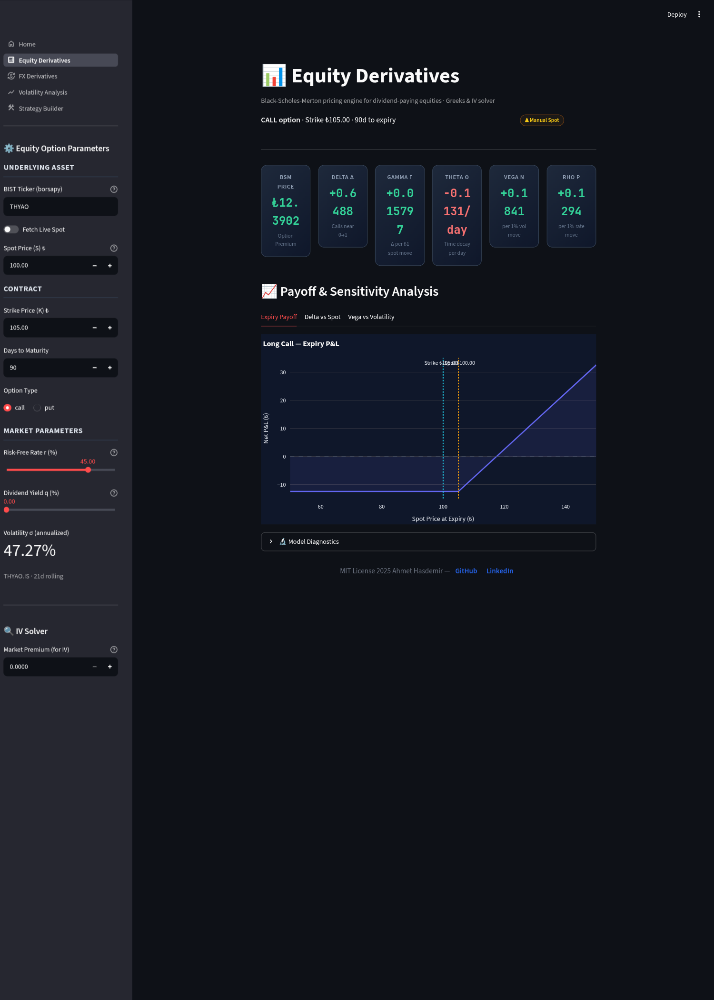
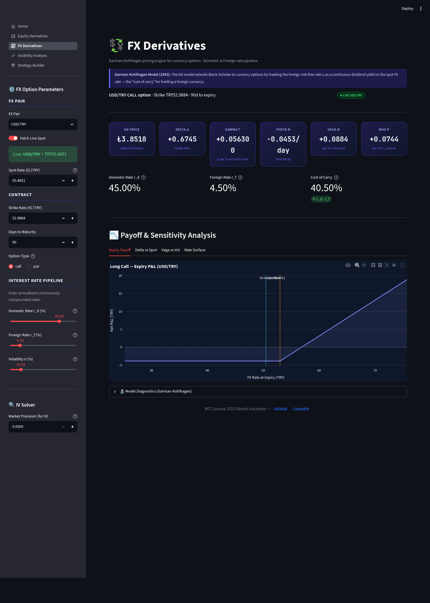
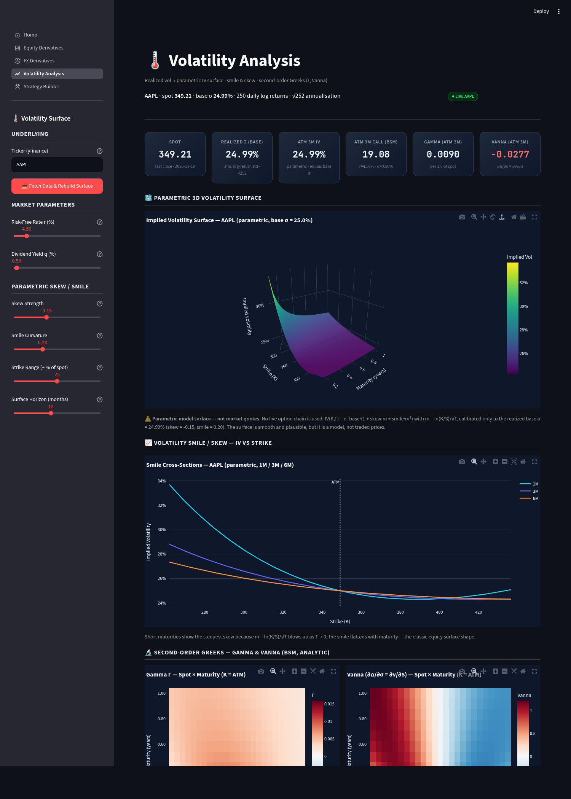
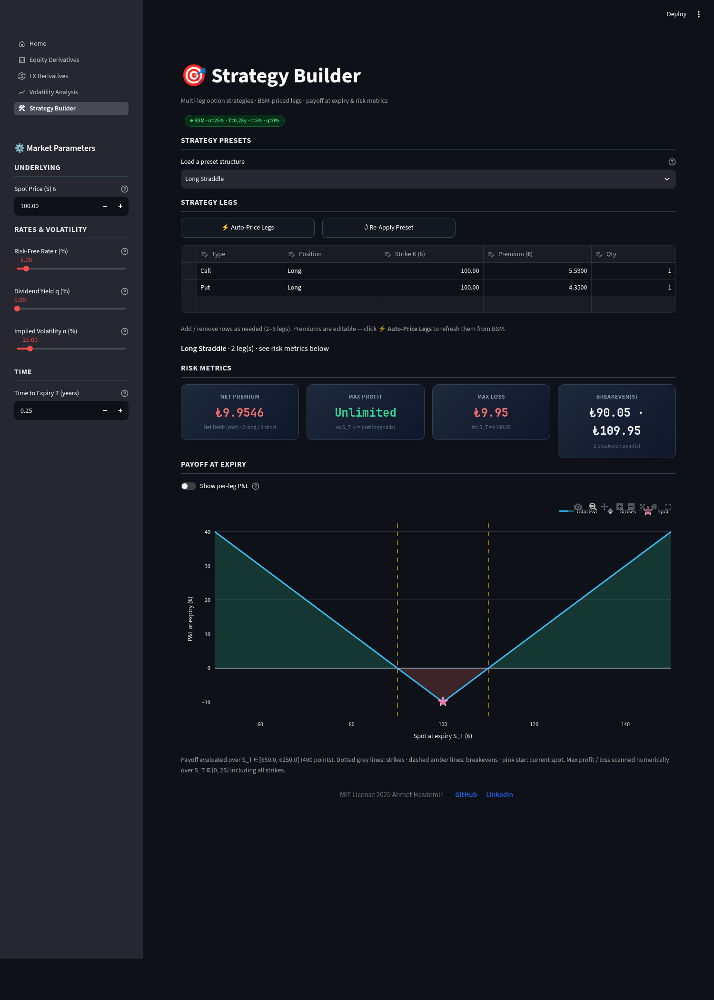
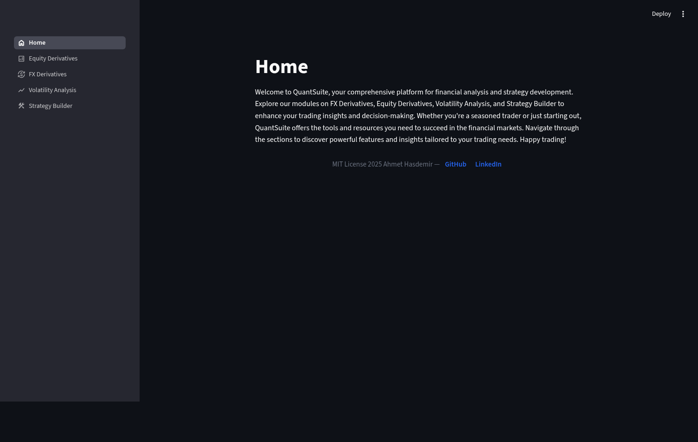

# QuantSuite: Multi-Asset Derivatives & Volatility Analytics

**QuantSuite** is a specialized toolkit for quantitative analysts and risk managers, designed to handle the mathematical complexities of both Equity and Foreign Exchange (FX) derivatives. By integrating stochastic calculus with high-performance Python libraries, QuantSuite provides a professional environment for pricing, hedging, and volatility analysis.

## 📄 Project Description
QuantSuite is a multi-asset derivatives pricing platform for Equity and FX. It features advanced Greeks analytics, 3D Volatility Surfaces, and a custom Newton-Raphson IV solver. Designed to bridge academic theory and trading desk requirements, it uses Black-Scholes and Garman-Kohlhagen models for professional-grade risk analysis.

---

## 🌟 Key Capabilities
* **Hybrid Pricing Engine:** Adaptive models for **Equity** (Dividend-adjusted Black-Scholes) and **FX** (Garman-Kohlhagen dual-interest rate model).
* **The Greeks Lab:** High-speed vectorized computation of Delta, Gamma, Theta, Vega, and Rho for multi-asset portfolios.
* **Volatility Intelligence:** A custom **Newton-Raphson** numerical solver to extract Implied Volatility (IV) from market premiums.
* **Surface Mapping:** Dynamic **3D Volatility Surfaces** (Maturity x Strike x IV) to visualize market expectations and term structures.
* **Strategy Simulation:** Interactive payoff diagrams for complex strategies like Iron Condors and Straddles, featuring real-time sensitivity analysis.

## 📸 Screenshots

### Equity Derivatives — BSM pricing, Greeks & IV solver

### FX Derivatives — Garman-Kohlhagen dual-rate pricing

### Volatility Analysis — 3D parametric surface, smile & second-order Greeks

### Strategy Builder — multi-leg payoff simulation & risk metrics

### Home

---

## 🧬 Evolution & Credits
**QuantSuite** is an advanced evolution of the **[Algo-Risk Monitor](https://github.com/ahasdemir/Algo-Risk-Monitor)** project. 
* The core `analysis_utils.py` and data-fetching framework were inherited from Algo-Risk Monitor and significantly expanded to support derivative-specific math and stochastic simulations.
* This lineage reflects a modular development approach, scaling foundational risk tools into niche quantitative applications.

---

## 🚀 Roadmap & Development Tasks

### Phase 1: Multi-Asset Engine (Week 3) — ✅ COMPLETE
- [x] Implement **Garman-Kohlhagen** pricing for FX pairs and **Black-Scholes-Merton** for dividend-paying equities.
- [x] Optimize the **Newton-Raphson IV Solver** for robust convergence across varying market conditions (bisection fallback).
- [x] Standardize the input pipeline for domestic ($r_d$) and foreign ($r_f$) risk-free rates.

### Phase 2: Advanced Visuals & Surfaces (Week 4) — ✅ COMPLETE
- [x] Deploy Plotly-based **3D Volatility Surfaces** to identify market skew and term structure.
- [x] Map the **Volatility Smile** to visualize tail-risk expectations in Equity vs. FX.
- [x] Create 2D sensitivity heatmaps for **Second-Order Greeks** (Gamma/Vanna).

### Phase 3: Trading Strategy & I/O (Week 5) — ✅ COMPLETE
- [x] Build a **Strategy Builder** with P&L simulations for multi-leg option spreads (6 presets: straddle, strangle, bull call, bear put, iron condor, butterfly).
-